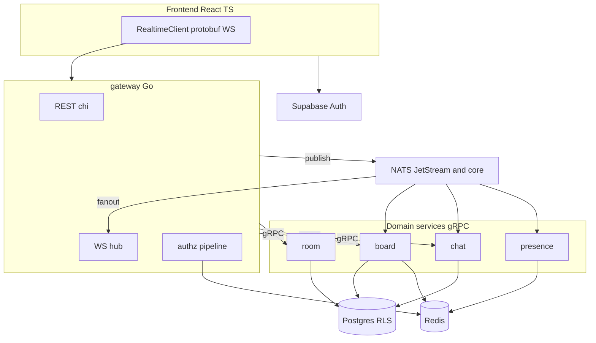

# Realtime Collaborative Whiteboard

[](https://github.com/drakeRAGE/Real-Time-Collaborative-Whiteboard/actions/workflows/ci.yml)
[](scripts/coverage-gate.ps1)

Five Go services, gRPC, NATS JetStream, protobuf WebSockets, Postgres, Redis, and a React 19 client. Draw in one browser; the other paints the same strokes, with live cursors and room chat.

<p align="center">
  
</p>

## Two browsers, one room

Alex creates the room and draws. Sam joins. The strokes, rectangle, and circle land on Sam's canvas, and Sam sees Alex's cursor. Undo, redo, clear, and delete stay on the room admin's toolbar.

<table>
  <tr>
    <td align="center" width="50%">
      <strong>Room admin</strong><br />
      
    </td>
    <td align="center" width="50%">
      <strong>Member</strong><br />
      
    </td>
  </tr>
</table>

Sam's chat message shows up on Alex's sidebar.

<p align="center">
  
</p>

Create or join a room after sign-in.

<p align="center">
  
</p>

## What you can do

- Draw with the pen and eraser. Rectangles and circles sync to the room.
- See other people's cursors.
- Chat, and see who is in the room.
- Place a WebRTC call. Signaling uses the same socket.
- Undo, redo, and clear on the server. Only the room admin can do it.

## Architecture



A stroke is a `ClientEnvelope` on `/ws` (`frontend/src/realtime/client.ts`). The gateway checks the JWT, membership, protovalidate, and the rate limit (`services/gateway/internal/authz/pipeline.go`), then publishes `wb.board.stroke.v1`. Board-service appends the op-log and publishes `wb.board.stroke_applied.v1`. `services/gateway/internal/fanout/fanout.go` delivers `ServerEnvelope` frames to the room.

## Quickstart

Docker Desktop, [Task](https://taskfile.dev), and Node.js. `task up` does not start the frontend.

```powershell
docker compose -f deploy/compose/docker-compose.yml down -v
task up
cd frontend
npm ci
copy .env.example .env
cd ..
task dev-frontend
```

Readiness is [http://localhost:8080/readyz](http://localhost:8080/readyz). The UI is [http://localhost:5173](http://localhost:5173). Set `VITE_APP_SUPABASE_URL`, `VITE_APP_SUPABASE_ANON_KEY`, and `VITE_BACKEND_URL` (`http://localhost:8080`). Compose verifies local HS256 tokens. Browser tests sign in against compose without a cloud project (`e2e/README.md`).

| What | URL |
| --- | --- |
| Gateway | http://localhost:8080/readyz |
| Frontend | http://localhost:5173 |
| Jaeger | http://localhost:16686 |
| Grafana | http://localhost:3000 (admin / admin) |
| Prometheus | http://localhost:9090 |

Full ports and health checks: [docs/runbooks/local-dev.md](docs/runbooks/local-dev.md).

## Observability

A board history read crosses three services. This trace is gateway → board → room, 11.67 ms, four spans.

<p align="center">
  
</p>

Grafana graphs Prometheus `up`. The Go processes do not export `/metrics`, so WebSocket connections, NATS lag, and request latency are not on this board.

<p align="center">
  
</p>

## Design notes

- [Go microservices](docs/adr/001-go-microservices.md)
- [NATS JetStream](docs/adr/002-nats-over-kafka.md)
- [Native WebSockets](docs/adr/003-native-websocket.md)
- [Op-log and snapshots](docs/adr/004-board-oplog.md)
- [Supabase JWTs verified with JWKS](docs/adr/005-supabase-jwks.md)
- [Server-side undo and redo](docs/adr/006-server-side-undo.md)

[Security](docs/SECURITY.md) · [Threat model](docs/THREAT_MODEL.md) · [Contracts](docs/CONTRACTS.md) · [Schema](docs/SCHEMA.md) · [Kubernetes](docs/runbooks/k8s.md)

## Measured locally

Committed Compose run in [load/REPORT.md](load/REPORT.md). k6 2.3.0, 20 virtual users, 2 rooms. The `fanout_latency` threshold is `p(99)<150`. Smoke still misses it after hub/fanout cursor-queue tuning.

| Metric | Smoke, 20 VUs (pre-tune) | Smoke, 20 VUs (2026-11-08) |
| --- | --- | --- |
| Result | exit 99 | exit 99 |
| errors | 0 | 0 / 13899 acks |
| fanout_latency median | 48 ms | 37 ms |
| fanout_latency p99 | 471 ms | 173 ms |
| ws upgrade | 51/51 status 101 | 51/51 status 101 |

```powershell
task lint
task test
task coverage
```

`task coverage` fails under 80% statement coverage in `pkg/` or 70% in a service module (`scripts/coverage-gate.ps1`). The coverage badge is that gate, not a hosted percentage.

## Current limits

- Fan-out p99 at 20 VUs is 173 ms (23 ms over 150 ms). The 100 VU run was not repeated after applied events got their own NATS message id.
- Grafana on Compose graphs Prometheus `up`. Application series are not emitted.
- Cloud migrations are recorded as not applied in [docs/runbooks/supabase-cloud.md](docs/runbooks/supabase-cloud.md).
- Helm charts are under `deploy/k8s/charts/`. `task kind-up` is in [docs/runbooks/k8s.md](docs/runbooks/k8s.md).
