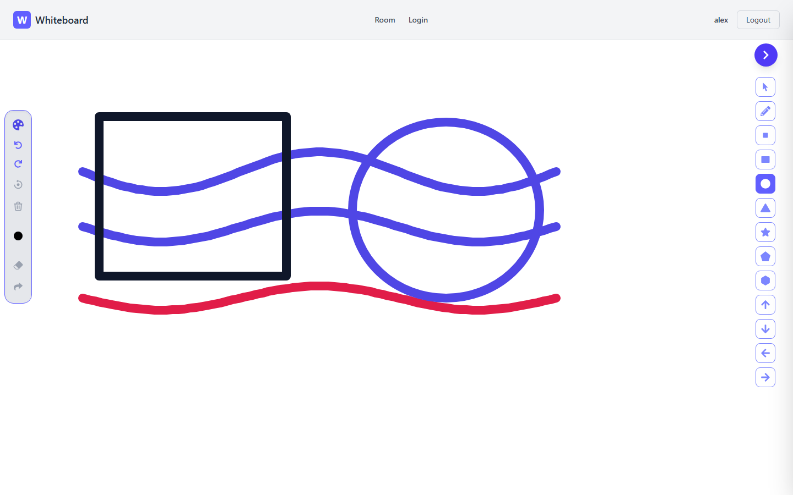
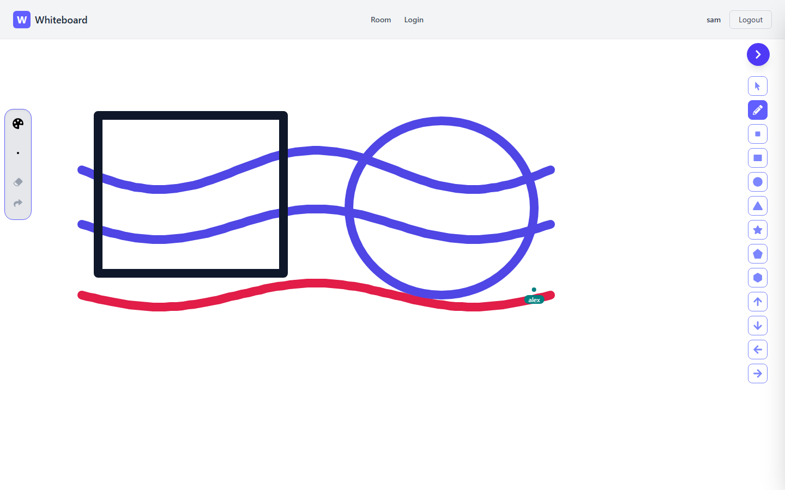
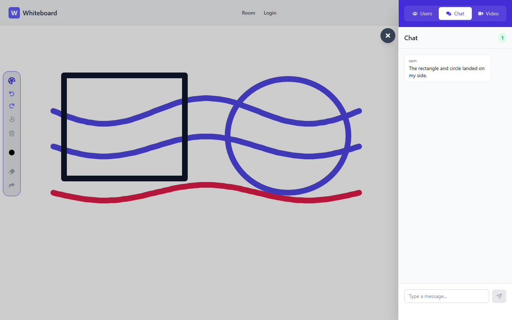
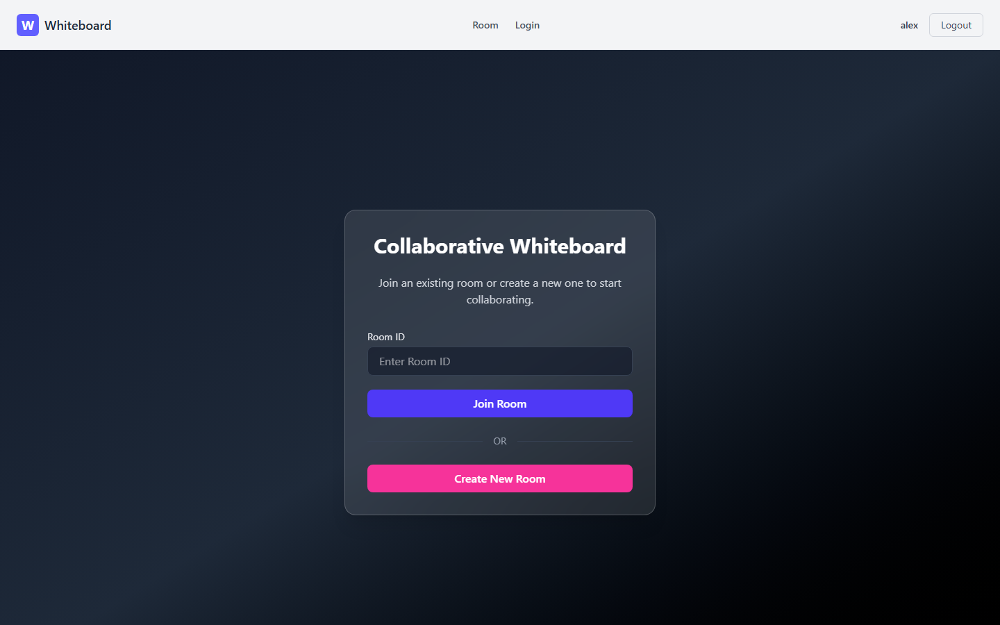
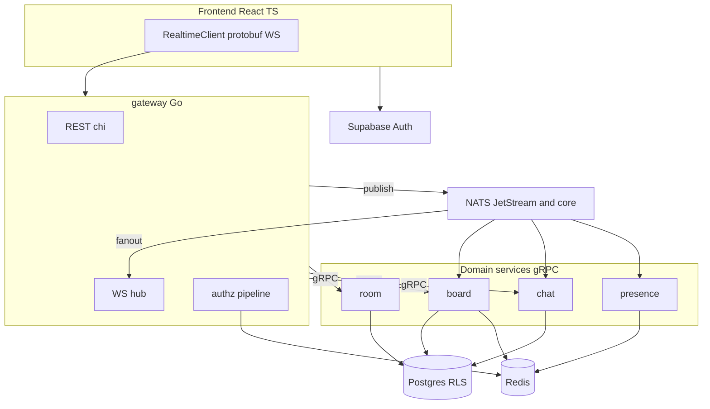
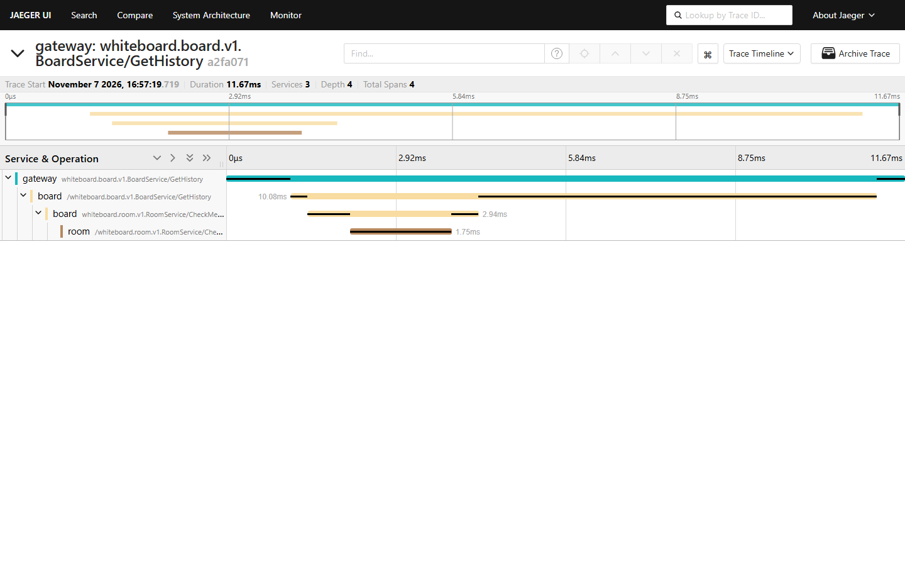
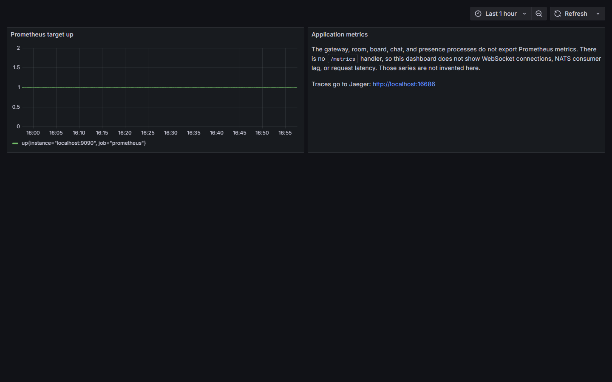

# Realtime Collaborative Whiteboard

[](https://github.com/drakeRAGE/Real-Time-Collaborative-Whiteboard/actions/workflows/ci.yml)
[](scripts/coverage-gate.ps1)
[](https://goreportcard.com/report/github.com/drakeRAGE/Real-Time-Collaborative-Whiteboard)

A multiplayer whiteboard: five Go services, gRPC, NATS JetStream, protobuf WebSockets, Postgres, Redis, and a React 19 client. Draw in one browser and the other browser paints the same strokes, with live cursors and room chat.



## Two browsers, one room

Alex creates the room and draws. Sam joins the same room. The strokes, rectangle, and circle arrive on Sam's canvas, and Sam sees Alex's cursor. Undo, redo, clear, and delete are on the room admin's toolbar.



Sam's chat message shows up on Alex's sidebar.



Create or join a room from the signed-in home screen.



## What you can do

- Draw with the pen and eraser. Rectangles and circles sync to the room (`frontend/src/components/Whiteboard.tsx`).
- See other people's cursors (`frontend/src/components/LiveCursors.tsx`).
- Chat, and see who is in the room (`frontend/src/components/Communication.tsx`).
- Place a WebRTC call. Signaling rides the same socket (`frontend/src/components/VideoCallSession.tsx`).
- Undo, redo, and clear on the server. Only the room admin can do it (`docs/adr/006-server-side-undo.md`).

## Architecture



A stroke is a `ClientEnvelope` on `/ws` (`frontend/src/realtime/client.ts`). The gateway checks the JWT, membership, protovalidate, and the rate limit (`services/gateway/internal/authz/pipeline.go`), then publishes `wb.board.stroke.v1`. Board-service appends the op-log and publishes `wb.board.stroke_applied.v1`. `services/gateway/internal/fanout/fanout.go` delivers `ServerEnvelope` frames to the room.

Go module prefix: `github.com/drakeRAGE/realtime-whiteboard` (`docs/OWNER.md`).

## Quickstart

Docker Desktop and [Task](https://taskfile.dev). Node.js for the Vite app. `task up` does not start the frontend.

```powershell
docker compose -f deploy/compose/docker-compose.yml down -v
task up
```

`task up` is `docker compose -f deploy/compose/docker-compose.yml up -d --build`. Readiness is [http://localhost:8080/readyz](http://localhost:8080/readyz). `task logs` follows logs. `task down` stops the stack and keeps volumes. `task down -- -v` drops them.

```powershell
cd frontend
npm ci
copy .env.example .env
cd ..
task dev-frontend
```

`task dev-frontend` runs Vite on port 5173. Set `VITE_APP_SUPABASE_URL`, `VITE_APP_SUPABASE_ANON_KEY`, and `VITE_BACKEND_URL` (`http://localhost:8080`). Compose verifies local HS256 tokens. A cloud Supabase project uses `SUPABASE_JWKS_URL` with that HS256 flag left false (`services/gateway/internal/config/config.go`). The browser tests sign in against compose without a cloud project (`e2e/README.md`).

| What | URL |
| --- | --- |
| Gateway readiness | http://localhost:8080/readyz |
| Frontend | http://localhost:5173 |
| Jaeger | http://localhost:16686 |
| Grafana | http://localhost:3000 (admin / admin) |
| Grafana dashboard | http://localhost:3000/d/whiteboard-dev/whiteboard-local |
| Prometheus | http://localhost:9090 |

Ports, health checks, and the local database are in [docs/runbooks/local-dev.md](docs/runbooks/local-dev.md).

## Observability

A board history read crosses three services. This trace is gateway to board to room, 11.67 ms, four spans.



Grafana is provisioned against Prometheus. The board shows that Prometheus is up. The Go processes do not export a `/metrics` handler, so WebSocket connections, NATS lag, and request latency are not on this dashboard.



## Design notes

- [Go microservices](docs/adr/001-go-microservices.md)
- [NATS JetStream](docs/adr/002-nats-over-kafka.md)
- [Native WebSockets](docs/adr/003-native-websocket.md)
- [Op-log and snapshots](docs/adr/004-board-oplog.md)
- [Supabase JWTs verified with JWKS](docs/adr/005-supabase-jwks.md)
- [Server-side undo and redo](docs/adr/006-server-side-undo.md)

Authorization: [docs/SECURITY.md](docs/SECURITY.md). Threat model: [docs/THREAT_MODEL.md](docs/THREAT_MODEL.md). Subjects: [docs/CONTRACTS.md](docs/CONTRACTS.md). Schema: [docs/SCHEMA.md](docs/SCHEMA.md). Kubernetes: [docs/runbooks/k8s.md](docs/runbooks/k8s.md).

## Measured locally

Figures are the committed Compose run in [load/REPORT.md](load/REPORT.md). k6 2.3.0, 20 virtual users, 2 rooms. The `fanout_latency` threshold is `p(99)<150`. This run missed it. The 500 VU profile was not started.

| Metric | Smoke, 20 VUs |
| --- | --- |
| Result | exit 99 |
| errors | 0 |
| fanout_latency median | 48 ms |
| fanout_latency p99 | 471 ms |
| ws upgrade | 51/51 status 101 |

```powershell
task lint
task test
task coverage
```

`task coverage` fails under 80% statement coverage in `pkg/` or 70% in a service module (`scripts/coverage-gate.ps1`). The coverage badge is that gate. It is not a hosted coverage percentage.

## Current limits

- The recorded 20 VU smoke is above the 150 ms fan-out target. [load/REPORT.md](load/REPORT.md) has the full table. The 100 VU run was not repeated after applied events got their own NATS message id.
- Grafana on this Compose stack graphs Prometheus `up`. Application series are not emitted.
- Cloud migrations are recorded as not applied in [docs/runbooks/supabase-cloud.md](docs/runbooks/supabase-cloud.md).
- Helm charts are under `deploy/k8s/charts/`. `task kind-up` is documented in [docs/runbooks/k8s.md](docs/runbooks/k8s.md).
