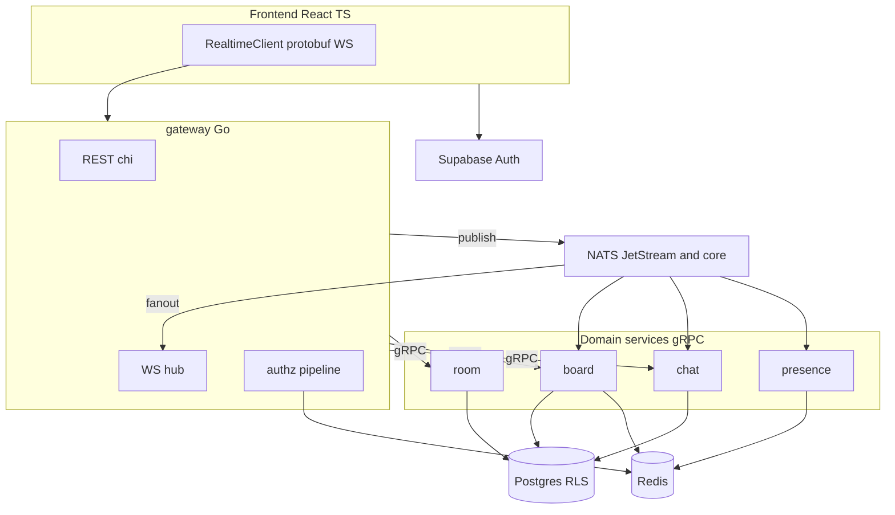

# Realtime Whiteboard

[](https://github.com/drakeRAGE/Real-Time-Collaborative-Whiteboard/actions/workflows/ci.yml)
[](scripts/coverage-gate.ps1)
[](https://goreportcard.com/report/github.com/drakeRAGE/Real-Time-Collaborative-Whiteboard)

Collaborative whiteboard: five Go services, gRPC, NATS JetStream, native protobuf WebSockets, Postgres, Redis, and a React 19 client. Module prefix: `github.com/drakeRAGE/realtime-whiteboard` (`docs/OWNER.md`).

## Architecture



A stroke is a `ClientEnvelope` on `/ws` (`frontend/src/realtime/client.ts`). The gateway checks the JWT, membership, protovalidate, and the rate limit (`services/gateway/internal/authz/pipeline.go`), then publishes `wb.board.stroke.v1`. Board-service appends the op-log and publishes `wb.board.stroke_applied.v1`. `services/gateway/internal/fanout/fanout.go` delivers `ServerEnvelope` frames to the room.

## Quickstart

Prerequisites: Docker Desktop and [Task](https://taskfile.dev). Node.js is required for the Vite app. `task up` does not start the frontend. Commands match `docs/runbooks/local-dev.md`.

From the repo root, with Docker Desktop running:

```powershell
docker compose -f deploy/compose/docker-compose.yml down -v
task up
```

`task up` is `docker compose -f deploy/compose/docker-compose.yml up -d --build`. Readiness is `http://localhost:8080/readyz`. `task logs` follows logs. `task down` stops the stack and keeps volumes. `task down -- -v` drops them.

The UI is a separate process. On a clean clone, install dependencies once, then start Vite:

```powershell
cd frontend
npm ci
cd ..
task dev-frontend
```

`task dev-frontend` runs `npm run dev` in `frontend` (port 5173). Copy `frontend/.env.example` to `frontend/.env` and set `VITE_APP_SUPABASE_URL`, `VITE_APP_SUPABASE_ANON_KEY`, and `VITE_BACKEND_URL` (`http://localhost:8080` is the example). Sign-in details and the local HS256 gateway are in `docs/runbooks/local-dev.md`.

| What | URL |
|---|---|
| Gateway readiness | http://localhost:8080/readyz |
| Frontend | http://localhost:5173 |
| Jaeger | http://localhost:16686 |
| Grafana | http://localhost:3000 (admin / admin) |
| Grafana dashboard | http://localhost:3000/d/whiteboard-dev/whiteboard-local |
| Prometheus | http://localhost:9090 |

## Design highlights

- [Go microservices instead of a modular monolith](docs/adr/001-go-microservices.md)
- [NATS JetStream instead of Kafka](docs/adr/002-nats-over-kafka.md)
- [Native WebSockets instead of Socket.IO](docs/adr/003-native-websocket.md)
- [Op-log and snapshots instead of a CRDT](docs/adr/004-board-oplog.md)
- [Supabase JWTs verified with JWKS](docs/adr/005-supabase-jwks.md)
- [Server-side undo and redo](docs/adr/006-server-side-undo.md)

Authorization matrix: [docs/SECURITY.md](docs/SECURITY.md). Threat model: [docs/THREAT_MODEL.md](docs/THREAT_MODEL.md). Subject list: [docs/CONTRACTS.md](docs/CONTRACTS.md). Schema: [docs/SCHEMA.md](docs/SCHEMA.md).

## Demo and observability

These are the portfolio media names from the Phase 14 plan. The files are not in the tree. Nothing below is a stand-in image.

| Plan name | Path | What is in the repo instead |
|---|---|---|
| Demo GIF, two-tab draw sync | `docs/assets/two-tab-draw-sync.gif` | `frontend/src/realtime/client.ts`, `services/gateway/internal/ws/hub.go` |
| Grafana screenshot | `docs/assets/grafana.png` | `deploy/compose/grafana/dashboards/whiteboard.json` |
| Jaeger trace screenshot | `docs/assets/jaeger-trace.png` | Jaeger UI after `task up`: http://localhost:16686 |

The provisioned dashboard plots Prometheus `up` and states that the Go processes do not export a `/metrics` handler, so WebSocket connections, NATS lag, and request latency are not on that board. Traces are OTLP from `pkg/otelx`.

## Load test

Figures are the committed local Compose run in [load/REPORT.md](load/REPORT.md). The 500 VU profile was not started. The 100 VU run missed `fanout_latency` `p(99)<150`.

| Metric | Smoke, 20 VUs | 100 VUs, 10 rooms |
|---|---|---|
| Result | exit 0 | exit 99 |
| errors | 0 | 0 |
| fanout_latency p99 | no stroke samples | 2m 10s |
| ws_msgs_received | 209121 | 1413208 |

The report attributes the 100 VU latency to board-ingest backlog and to applied events that reused the ingest `Nats-Msg-Id`. Current publish code uses a distinct id: `appliedMessageID` in `services/board/internal/service/board.go`. That change is not a new load run. The duplicate window in `pkg/natsx/natsx.go` is still 2 minutes.

## Operations

- Local stack: [docs/runbooks/local-dev.md](docs/runbooks/local-dev.md)
- Kubernetes: [docs/runbooks/k8s.md](docs/runbooks/k8s.md)
- Supabase cloud: [docs/runbooks/supabase-cloud.md](docs/runbooks/supabase-cloud.md)

```powershell
task lint
task test
task coverage
```

`task coverage` fails under 80% statement coverage in `pkg/` or 70% in a service module (`scripts/coverage-gate.ps1`).

## Limitations and roadmap

- The coverage badge is the gate in `scripts/coverage-gate.ps1`. It is not a hosted coverage percentage. The Go Report Card badge tracks the GitHub repository. This repo is a `go.work` with several modules.
- `load/REPORT.md` does not show a passing 150 ms fan-out at 100 VUs, and it does not contain a 500 VU run.
- Grafana on the Compose stack does not graph application series. See the text panel in `deploy/compose/grafana/dashboards/whiteboard.json`.
- `docs/runbooks/supabase-cloud.md` records that cloud migrations were not applied. Compose verifies HS256 with `SUPABASE_JWT_ALLOW_HS256` (`deploy/compose/docker-compose.yml`). Cloud asymmetric tokens need `SUPABASE_JWKS_URL` and the HS256 flag left false (`services/gateway/internal/config/config.go`).
- Helm charts are under `deploy/k8s/charts/`. `task kind-up` is documented in `docs/runbooks/k8s.md`. This README does not claim a fresh kind install was timed.
- Two-tab draw sync, the Grafana board, and a Jaeger trace are not recorded as files under `docs/assets/`.
